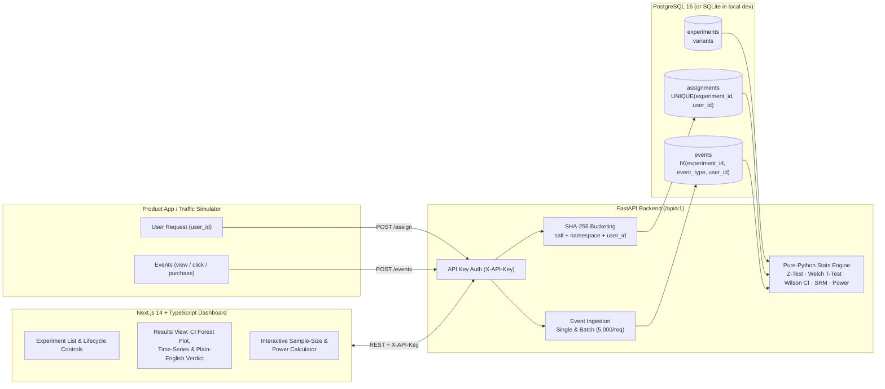
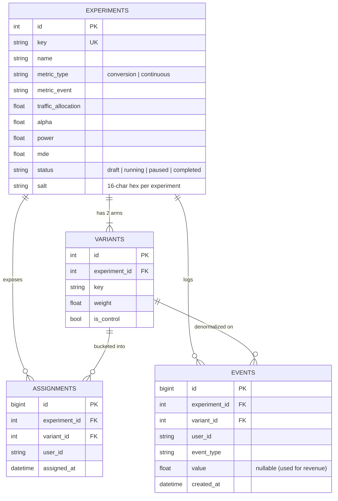

# ExperimentIQ — Statistical A/B Testing Platform

> **An experimentation platform that tells teams whether a product change actually worked, backed by sound statistics.**

[](https://github.com/Sohil3004/A-B-Testing/actions)


-emerald)

**Live Demo:** [https://experimentiq-ab.vercel.app](https://experimentiq-ab.vercel.app) *(Dashboard)* &middot; [https://experimentiq-api.onrender.com/docs](https://experimentiq-api.onrender.com/docs) *(OpenAPI / Swagger UI)*

---

## Why ExperimentIQ Exists

Shipping a product change and watching a metric go up is not proof that the change caused the improvement. Random noise, sample-ratio bugs, underpowered sample sizes, and mid-experiment "peeking" routinely trick teams into shipping regressions.

**ExperimentIQ** is a full-stack experimentation platform that handles the entire lifecycle of a controlled two-arm A/B test:

1. **Pre-register** an experiment with a hypothesis, primary success metric (`conversion` or `continuous`), traffic allocation, variant split, significance level ($\alpha$), statistical power ($1 - \beta$), and minimum detectable effect (MDE).
2. **Assign users deterministically** via `POST /api/v1/assign` using salted SHA-256 hashing so the same `user_id` always sees the same variant across stateless API replicas.
3. **Ingest events** (`view`, `click`, `purchase`, `revenue`) via single or batch endpoints (`POST /api/v1/events`, `POST /api/v1/events/batch`).
4. **Analyze results** with a pure-Python statistical engine (verified against SciPy across **490 automated tests** to $10^{-9}$ relative tolerance) that outputs confidence intervals, $p$-values, Sample Ratio Mismatch ($\chi^2$) alerts, sample-size progress, and a plain-English verdict.

---

## System Architecture



### Relational Schema



---

## Deterministic Hashing & Consistent Assignment

When an application calls `POST /api/v1/assign` with `{ "experiment_key": "checkout-cta-colour", "user_id": "user-42" }`, ExperimentIQ maps the user onto the unit interval $[0, 1)$ using the first 64 bits of SHA-256:

$$\text{bucket}(s, \text{ns}, u) = \frac{\text{uint64\_be}\!\left(\text{SHA256}(s \mathbin{\Vert} \text{":"} \mathbin{\Vert} \text{ns} \mathbin{\Vert} \text{":"} \mathbin{\Vert} u)_{0..7}\right)}{2^{64}} \in [0, 1)$$

Key design properties in [`backend/app/assignment.py`](backend/app/assignment.py):

- **Stateless & Idempotent:** The same `(experiment, user_id)` pair always hashes to the exact same variant across server restarts or horizontal replicas.
- **Per-Experiment Salt (`s`):** Every experiment generates its own random salt on creation so user assignments are statistically independent across concurrent experiments (preventing carry-over bias).
- **Orthogonal Namespaces (`allocation` vs. `variant`):** We hash twice with distinct namespaces—first `SHA256(salt + ":allocation:" + user_id)` to decide whether the user enters the experiment when `traffic_allocation < 1.0`, and second `SHA256(salt + ":variant:" + user_id)` to choose the variant. Reusing a single hash for both would correlate traffic allocation with variant assignment!

---

## Statistical Methodology & SciPy Verification

Rather than treating SciPy as a black box at runtime, [`backend/app/stats/`](backend/app/stats/) implements the probability distributions and hypothesis tests from first principles in pure Python—and [`backend/tests/test_stats_vs_scipy.py`](backend/tests/test_stats_vs_scipy.py) verifies every function against `scipy.stats` and `scipy.special` to **$10^{-9}$ relative accuracy**.

### 1. Conversion Metrics — Two-Proportion $z$-Test & Wilson Intervals
- **Denominator discipline:** Every assigned user in `assignments` is included in $n_C$ and $n_T$. A user who fires at least one `metric_event` counts as 1 conversion ($x_C, x_T$).
- **Pooled SE for the test statistic** (exact under $H_0: p_C = p_T$):
  $$z = \frac{\hat{p}_T - \hat{p}_C}{\sqrt{\hat{p}_{\text{pool}}(1 - \hat{p}_{\text{pool}})\left(\frac{1}{n_C} + \frac{1}{n_T}\right)}}, \quad \hat{p}_{\text{pool}} = \frac{x_C + x_T}{n_C + n_T}$$
- **Unpooled SE for the confidence interval** (correct under $H_1$ where $p_C \neq p_T$) and **Delta Method** for the relative lift $(\hat{p}_T - \hat{p}_C)/\hat{p}_C$ confidence interval.
- **Wilson Score Interval** for per-variant conversion rates, avoiding the negative lower bounds and poor small-sample coverage of textbook Wald intervals.

### 2. Continuous Metrics (Revenue) — Welch's $t$-Test & Welford's Algorithm
- User-level values are summed per assigned user (non-converting users contribute $0.0$, preserving randomized intent-to-treat).
- Sample mean and unbiased variance ($s^2$, `ddof=1`) are accumulated in a single numerically stable pass via **Welford's online algorithm**.
- **Welch's unequal-variance $t$-test** with **Welch–Satterthwaite degrees of freedom**:
  $$t = \frac{\bar{Y}_T - \bar{Y}_C}{\sqrt{\frac{s_T^2}{n_T} + \frac{s_C^2}{n_C}}}, \quad \nu = \frac{\left(\frac{s_T^2}{n_T} + \frac{s_C^2}{n_C}\right)^2}{\frac{(s_T^2 / n_T)^2}{n_T - 1} + \frac{(s_C^2 / n_C)^2}{n_C - 1}}$$
- Two-sided $p$-values and quantiles are evaluated using the regularized incomplete beta function $I_x(a, b)$ (`betainc`) via modified Lentz continued fractions and Stirling asymptotic log-gamma expansion.

### 3. Sample-Size & Statistical Power Calculator
- **Proportions (Fleiss formula without continuity correction):**
  $$n = \frac{\left(z_{1-\alpha/2}\sqrt{2\bar{p}(1-\bar{p})} + z_{1-\beta}\sqrt{p_1(1-p_1) + p_2(1-p_2)}\right)^2}{(p_2 - p_1)^2}$$
- **Continuous Means:**
  $$n = \frac{2\left(z_{1-\alpha/2} + z_{1-\beta}\right)^2 \sigma^2}{\Delta^2}$$

### 4. Sample Ratio Mismatch (SRM) Guardrail
Before trusting any $p$-value, ExperimentIQ runs a Pearson $\chi^2$ goodness-of-fit test comparing observed user counts $(n_C, n_T)$ against the configured variant weights at a strict $\alpha_{\text{SRM}} = 0.001$. If triggered, the dashboard surfaces a prominent warning that assignment or event logging is likely biased.

---

## Understanding the "Peeking" Problem

One of the most common mistakes in product analytics is checking an experiment dashboard every morning and stopping the test the moment $p < 0.05$.

Under the null hypothesis ($H_0$: the change has **zero** true effect), a single fixed-horizon test at $\alpha = 0.05$ has a $5\%$ false-positive rate. However, if you peek at the cumulative $p$-value after every batch of users and stop as soon as $p < 0.05$, your actual Type I error rate balloons dramatically:

| Number of Looks ($K$) | Nominal $\alpha$ | Actual False-Positive Rate |
| :--- | :--- | :--- |
| 1 (Fixed Horizon) | $5.0\%$ | **$5.0\%$** |
| 5 looks | $5.0\%$ | **$\approx 14.2\%$** |
| 20 looks | $5.0\%$ | **$\approx 24.6\%$** |
| Continuous monitoring | $5.0\%$ | **$\to 100\%$ as $n \to \infty$** |

### How ExperimentIQ Protects Teams Against Peeking
1. **Up-front Sample Size Requirement:** Every experiment computes the required sample size per variant ($N_{\text{req}}$) for its pre-registered MDE, $\alpha$, and power $(1 - \beta)$.
2. **Minimum Sample Floor & Progress Tracking:** Below the minimum sample floor, the verdict engine refuses to call a winner regardless of the $p$-value (`not_enough_data`).
3. **Explicit Early-Significance Warning:** If $p < \alpha$ *before* the experiment reaches $N_{\text{req}}$, ExperimentIQ displays an explicit peeking warning on the results page advising the team to wait until $100\%$ of the planned sample size is collected.
4. **Cumulative $p$-Value Trajectory Chart:** The results page plots the historical evolution of the $p$-value alongside cumulative conversion/revenue so analysts can see noisy early crossings of $p = \alpha$.

---

## Demo Scenarios Included in the Traffic Simulator

Running `python -m simulator.simulate --reset` populates 7 realistic experiments with known ground truth so you can verify that the engine detects real winners and regressions while refusing to hallucinate effects on null tests:

| Experiment Key | Metric | Status | Ground Truth | Expected Verdict |
| :--- | :--- | :--- | :--- | :--- |
| `checkout-cta-colour` | `conversion` (`purchase`) | `completed` | **+17.5% real lift** (4.0% $\to$ 4.7%) | **Treatment is significantly better** ($p < 0.001$) |
| `homepage-hero-copy` | `conversion` (`signup`) | `completed` | **No real effect** (10.0% vs 10.0%) | **No significant difference** (full sample reached) |
| `bundle-upsell` | `continuous` (`revenue`) | `completed` | **+16.7% higher AOV** (\$48 $\to$ \$56) | **Treatment is significantly better** (Welch $t$-test) |
| `free-shipping-banner` | `continuous` (`revenue`) | `running` | **No real effect** (\$42 vs \$42) | **No significant difference** |
| `search-autocomplete-v2` | `conversion` (`purchase`) | `paused` | **-10.0% regression** (12.0% $\to$ 10.8%) | **Treatment is significantly worse** |
| `onboarding-checklist` | `conversion` (`activated`) | `running` | **+5% small lift, tiny $n$** | **Not enough data yet** (underpowered) |
| `pricing-page-annual-toggle` | `conversion` (`subscribe`) | `draft` | Not started (0 users) | **Not enough data yet** |

---

## Quickstart

### Option A: Docker Compose (PostgreSQL 16 + FastAPI + Seeder + Next.js)

```bash
docker compose up --build
```

- **Dashboard:** [http://localhost:3000](http://localhost:3000)
- **FastAPI + Swagger Docs:** [http://localhost:8000/docs](http://localhost:8000/docs)
- **Default API Key:** `dev-secret-key`

### Option B: Local Development (Zero-Docker SQLite Fallback)

**1. Backend & Traffic Simulator**
```bash
cd backend
python -m venv .venv
# Windows PowerShell:
.\.venv\Scripts\Activate.ps1
# macOS / Linux:
# source .venv/bin/activate

pip install -r requirements-dev.txt

# Run the 490-test suite (including SciPy verification)
pytest

# Seed the local database with the 7 demo experiments
python -m simulator.simulate --reset --scale 0.25

# Start the API server on http://localhost:8000
uvicorn app.main:app --reload --port 8000
```

**2. Frontend Dashboard**
```bash
cd frontend
npm install
npm run dev
```
Open [http://localhost:3000](http://localhost:3000) to explore the experiments, results charts, live assignment sandbox, and sample-size calculator.

---

## API Reference Summary

All `/api/v1/*` endpoints require the header `X-API-Key: dev-secret-key`.

| Method & Path | Description |
| :--- | :--- |
| `POST /api/v1/experiments` | Create a new two-arm A/B experiment |
| `GET /api/v1/experiments` | List experiments (optional `?status=running`) |
| `GET /api/v1/experiments/{id}` | Retrieve experiment metadata and assigned user count |
| `PATCH /api/v1/experiments/{id}` | Update metadata (statistical design is locked once started) |
| `POST /api/v1/experiments/{id}/start` | Start a `draft` or resume a `paused` experiment |
| `POST /api/v1/experiments/{id}/pause` | Pause a `running` experiment |
| `POST /api/v1/experiments/{id}/end` | Mark an experiment `completed` |
| `GET /api/v1/experiments/{id}/results` | Compute full statistical analysis, CIs, SRM, time-series, and verdict |
| `POST /api/v1/assign` | Deterministically assign a `user_id` to a variant |
| `POST /api/v1/events` | Log a single user event (`view`, `click`, `purchase`, etc.) |
| `POST /api/v1/events/batch` | Bulk-ingest up to 5,000 events in one request |
| `POST /api/v1/stats/sample-size` | Compute required per-variant sample size, power, and run duration |

---

## Intentional Scope & Future Work

To keep the core statistical engine and engineering rock-solid, the following features were deliberately left out of v1 and represent natural next steps:

- **Multi-variant ($A/B/n$) experiments & multiple-comparison corrections:** Extending beyond two arms with Holm–Bonferroni or Dunnett corrections to control Family-Wise Error Rate (FWER).
- **Guardrail & secondary metrics:** Supporting multiple metrics per experiment (e.g., primary conversion + latency/crash guardrails).
- **Always-valid sequential testing (mSPRT) & Bayesian analysis:** Adding mixture Sequential Probability Ratio Tests or alpha-spending boundaries (O'Brien–Fleming) so teams can legally monitor and stop experiments at any time without inflating false positives.
- **CUPED variance reduction:** Using pre-experiment covariates to shrink confidence intervals and speed up experiments on continuous metrics.
- **User accounts, RBAC & audit logs:** Replacing the shared `X-API-Key` header with organization/team authentication.
- **Lightweight client SDKs & streaming ingestion:** Releasing TypeScript/Python SDKs with local hash evaluation and Kafka/ClickHouse event streaming for high-throughput production traffic.
- **Cohort segmentation:** Slicing experiment results by country, device type, or new-vs-returning user segments.
